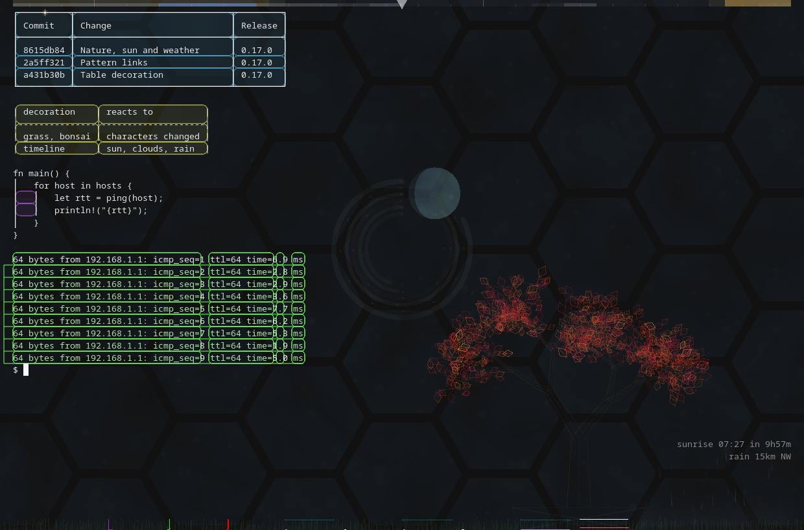
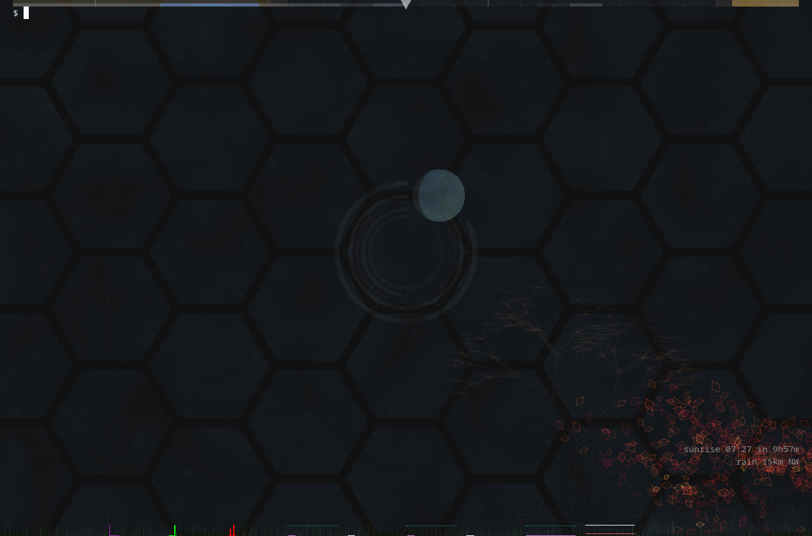

# Chartacritty = Alacritty plus charts and other useless decorations

Last updated to:
- Alacritty Terminal v0.26.0
- Alacritty (base) 0.17.0


The [full resolution video](https://github.com/sebosp/chartacritty/releases/download/v0.17.0-dev/chartacritty-demo.mp4)
is attached to the [v0.17.0-dev release](https://github.com/sebosp/chartacritty/releases/tag/v0.17.0-dev).





## About

This is a modified version of Alacritty that includes:

- Drawing time series charts (prometheus based or internal counters)
- Drawing prometheus alerts, static reference units and other decorations on the time series (see below for example).
- Hexagon background decorations (Like James Webb Telescope, Starcraft).
- Nannou decorations (these are decorations that can be generated by creating lyon tesselations, text and wgpu not supported yet).
- Moon phase decorations (Gather moon-phase data and use lyon to draw it).
- "Suspended in a light beam" (from Sagan's poem The Pale Blue Dot). a beam of "light" that travels through the background decorations "now and then".
- Shader Toy [Vortex Street](https://www.shadertoy.com/view/MlS3Rh)
- Shader Toy [Snowy](https://www.shadertoy.com/view/4dl3R4)
- Decorations that read the text on screen: tables, grid lines, repeated text and the links between its patterns.
- Nature: faint grass and an origami red maple bonsai moving in a wind made by the changes on screen.
- Sunrise, sunset and rain forecast for your rough location, with a 24 hour timeline along the top.

See the [CHANGELOG](./CHANGELOG.md) for what changed in each release.

## Configuration

Chartacritty reads `~/.config/chartacritty/chartacritty.yml` (or `chartacritty.toml`), it does not
read Alacritty's config. The [example config](./chartacritty.yml) is the setup of the screenshots
and documents every option, all of the decorations below are enabled by default.

## Decorations from the screen contents

These decorations look at the characters on screen, they are drawn behind the text.

- `grid_lines`: runs of line characters, i.e. nvim indent guides `▏ ▏ ▏` or `│` borders, are drawn
  as continuous lines, trimmed to the reach of their end characters, with a star travelling from
  line to line.
- `repeated_text`: lines similar to each other, i.e. `ping` output, have their repeated text dimmed
  (longer than 4 alphanumeric characters) and the parts that differ highlighted. Hovering a
  pattern outlines it everywhere on screen.
- `pattern_links`: faint lines in the padding link the lines sharing a pattern, patterns on the
  right half of the screen are linked from the right side of the window.
- `tables`: the cells of box drawing tables and markdown/ASCII tables (`| a | b |`, `+---+`) are
  drawn as rounded rectangles, each table in its own color.

```yaml
decorations:
  grid_lines:
    enabled: true
  repeated_text:
    enabled: true
  pattern_links:
    enabled: true
  tables:
    enabled: true
```

## Nature

Faint grass along the bottom of the window and a big origami red maple bonsai made of outlined
triangles. Each leaf is tied to the trunk by one vertex and slowly rotates, now and then a bit
brighter.

The grass and the bonsai share a wind that blows with the number of characters and colors that
change on screen between frames (not the redraws): while the terminal is idle the leaves grow, a
burst of output makes the wind stronger, shakes the leaves and blows them to the ground, and they
grow back once the terminal is calm again.

```yaml
decorations:
  nature:
    grass: true
    grass_lines: 1.2     # Height of the grass in lines
    bonsai: true
    bonsai_x: 0.72       # 0 is the left of the window, 1 its right
    bonsai_height: 0.6   # Share of the window height
    alpha: 1.0           # Multiplies the opacity of the grass and the bonsai
```

## Sun and weather

With a rough location (it does not need to be precise), chartacritty computes the sunrise and the
sunset (NOAA solar equations) and fetches the forecast around you from
[Open-Meteo](https://open-meteo.com) in the background, no API key needed. Only the configured
coordinates and 16 points around them, 15 and 35 km away, are sent.

- The bottom right corner, next to the charts, shows how long until the next sunrise or sunset,
  so you know when you can go for a walk, and whether rain is falling, coming or nearby, so you
  know if you can run for groceries. A rain shader falls in that corner while it rains or rain is
  coming.
- A timeline along the top of the window goes from 12 hours ago on the left to 12 hours ahead on
  the right, with a small triangle pointing down at the current time. The daylight is a faint sun
  color, brighter for the sunlight left today, clouds are white-ish and rain is blue-ish. It uses
  up to 12 pixels of `window.padding.y` when set.

```yaml
decorations:
  location:
    latitude: 52.37
    longitude: 4.90
  weather:
    enabled: true
    sun: true
    rain: true
    columns: 32
    lines: 6
    refresh_minutes: 10
    timeline: true
    timeline_height: 6.0
```

## Nannou State

The nannou decorations use [nannou_draw](https://github.com/nannou-org/nannou) 0.20 (bevy) from the
fork [sebosp/nannou](https://github.com/sebosp/nannou), only to tessellate, the vertices are drawn
by chartacritty's OpenGL renderer.

## Integrating Shader Toys

### Uniforms
A uniform is a value that is sent from the rendering loop in the rust code to the shader code in the GPU.

#### Time

There are references to `iTime` in the shader, this should be the time in seconds since the application started.
If your shader looks static and it should be moving (or is too fast).
you must change the `iTime`, i.e. multiply or divide `iTime` in the shader by, say, `200.`, `1000.`,
until you find a comfortable speed that is not too distracting to your workflow.

#### Resolution

The uniform `iResolution` is sent from the terminal `SizeInfo` to the shader on resizes and redraws.
Generally you won't need to play around this uniform, unless you want to change a specific shader effect size.

#### Channel0

Some shaders reference iChannel0 and use it as a base.
Where possible I change references to iChannel0 to the `base` color, which contains the hexagons, lyon polar clock, etc.
There is one texture loaded in the terminal for the glyphs.
You may get away with using it by adding one more uniform:
`uniform sampler2D iChannel0;` at the top of the file.
Mind you this texture is drawn *below* the visible screen,
so you must substract some `y` values to get it to render on screen and not show completely empty.

### `mainImage` modifications

The code on `mainImage` is called on shadertoys web ui for any shader.
Since we use multiple shaders at the same time, they must be renamed to avoid collisions.
For example, for vortex street I renamed `mainImage` to `vortex_street`.

#### Step by Step

Copy all the shader definition in shadertoys.

Imagine you have a `someOperations()` function that changes the colors/etc.:

```glsl
vec3 someOperations(vec2 coord) {
  // ...
}
void mainImage (out vec4 fragColor, in vec2 fragCoord){
  // Any references to `fragCoord` must be replaced to `gl_FragCoord` in the new version.
  // Then we must find what sets the fragColor and return the final value
  fragColor = someOperations(fragCoord.xy);
}
```

Paste it above `main()` in `alacritty/res/hex_bg.f.glsl`
The return type and the parameters of `mainImage` must be adjusted.

```glsl
vec3 someOperations(vec2 coord) {
  // ...
}
// You may want to send the base color parameter, for example,
// The polar clock re-uses this same shader at this moment.
color_t vortex_street(color_t base){
  color_t res = someOperarions(gl_FragCoord.xy);
  // You may also want to preserve the alpha from the base color
  return vec4(res.r, res.g,  res.b, base.a);
}
void main() {
  // ...
  FRAG_COLOR = vortex_street(color);
}
```

### Merge Requests are welcome

Feel free to add a merge request if you find a shader, one that looks nice... and not too expensive.


### Deep dive into the code

An unnecessarily long version of the above explanation that ties the alacritty
terminal and the decorations together can be seen in
[youtube](https://www.youtube.com/watch?v=ETlmM_0-y9k)

## Why

I feel I got enough CPU/GPU power to add a few vertices and bridge generative art, monitoring and alacritty.

The goal is to make environment immerssive and learn about terminals, generative art, astronomy.

And just have fun in general...

## TODO:
- The toml configuration for the charts/decorations looks ugly since it's array based. As much as I hate yaml I don't know how to properly encode the same functionality there without making a mess.

## Mirror the screenshot setup

The [example config](./chartacritty.yml) is the setup of the screenshots, copy it to
`~/.config/chartacritty/chartacritty.yml` and point the prometheus charts to your own Prometheus.
The charts can be toggled with `Alt+,` (`ToggleChartShow`).
